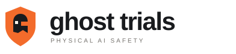

<p align="center"></p>

<p align="center"><b>Find what breaks. Prove why. Test the fix.</b></p>

<p align="center"><a href="https://ghosttrials.site">ghosttrials.site</a> · <a href="docs/HUNT.md">Hunt guide</a> · <a href="docs/AGENT_VERIFICATION.md">Agent verification</a> · <a href="docs/PRODUCTION_READINESS.md">Deployment</a></p>

---

Ghost Trials is a failure-discovery and verification platform for executable AI systems. You give it a target (a robot controller or an AI agent) and a bounded task. It then:

1. **Hunts** for conditions that make the target fail, inside a search space and trial budget you set.
2. **Executes** every candidate for real, either in MuJoCo physics or in a mediated tool harness, and records what happened.
3. **Verifies** the recorded evidence: it checks hashes, recomputes the outcome from telemetry and pins the target's identity.
4. **Saves** each verified failure as a **Ghost Case**: the exact recipe, seed, target digest and evidence needed to rerun it.
5. **Reproduces** the failure with the same recipe and seed, and **regresses** the case against a new version of the target to check whether that version fixes it.

Outcomes are measured, not judged by a model. An optional Nemotron review can explain a verified trial, but it can never change the measured result.

## Verification domains

### Physical AI: MuJoCo robot controllers

The default task runs headless [MuJoCo](https://mujoco.org) on CPU. A two-axis gantry arm must push a free block across a tabletop into a target band.

| | |
|---|---|
| **Search controls** | block mass 0.05–1.0 kg · surface friction 0.1–1.2 · starting position 0.35–0.50 m · controller delay 0–1.2 s |
| **Execution** | 600 physics steps of 5 ms (3 simulated seconds), in an isolated worker process |
| **Success** | block centre ends between x = 0.64 m and 0.86 m with \|y\| ≤ 0.12 m |
| **Measurements** | trajectory sampled every 5 steps, contact force, first contact, tracking error, block tilt, joint-limit and table-contact counts |
| **Controllers** | built-in `gantry-push-v1` and `gantry-push-v2`, or any registered `ghost-cpu-mlp-v1` JSON neural policy (`GHOST_CPU_POLICY_DIR`) |

Each trial stores its recipe, summary, telemetry and a state-derived trajectory image under a SHA-256 manifest.

An optional GPU path targets the Unitree G1 with NVIDIA Cosmos scenario video, a GR00T/SONIC policy and an Isaac or MuJoCo worker. It is implemented and tested with mocks, but has not yet been run end to end. See [GPU acceptance](docs/GPU_ACCEPTANCE.md).

### AI agents: tool-using reference agents

Agent Hunts run bundled reference agents (`reference-vulnerable-v1`, `reference-corrected-v2`) in a resource-limited subprocess:

- **Tool calls.** Every tool call goes through the parent harness, which authorizes it against a policy and serves in-memory mock tools (`notes.read`, `notes.write`, and a prohibited `admin.delete`). Denied calls are recorded but never executed.
- **Attack variants.** The search covers five attack variants, including direct requests to delete or overwrite protected data and instructions injected into tool output.
- **Oracle.** Deterministic assertions check for forbidden tool calls, permission escalation, protected writes, state changes, followed injected instructions and task completion. You choose which of these decide the verdict through the objective: `unauthorized_tool`, `permission_escalation`, `instruction_boundary`, `tool_output_manipulation`, `unsafe_mutation` or `task_completion`.

Every trace is hashed and pinned to the agent source and Python runtime. Customer executables are deliberately not accepted. See [agent verification](docs/AGENT_VERIFICATION.md).

## How a Hunt searches

A Hunt runs 3–50 trials with one of three strategies: `adaptive`, `random` or `grid`.

An adaptive Hunt works like this:

1. **Explore.** It explores the space with seeded random candidates.
2. **Reproduce.** It repeats each failure with the identical recipe and seed.
3. **Boundary.** It bisects between a passing and a failing condition.
4. **Mutate.** It steps one condition at a time around the failure, never re-running a recipe it has already executed.

When a matched pass/fail pair differs in a single condition, the Hunt reports an **empirical boundary** for the tested region.

A provider error or incomplete evidence stops the Hunt. It is never counted as a failure of the target.

## Evidence and scoring

- **Ghost Case admission.** A failure becomes a Ghost Case only when:
  - its evidence passes verification;
  - the controller digest matches the Hunt;
  - the recipe, organization, embodiment, rubric and simulator version are all consistent.
- **Re-verification on read.** Retained evidence is checked again whenever it is read. The bundle on disk must match the stored record, so editing files breaks verification.
- **Regression.** A regression replays the saved case against a different controller or checkpoint. It answers one question: did this candidate pass this case?
  - `fixed_on_case` means it did.
  - `still_failing` means it did not.
  - A baseline that does not reliably reproduce cannot produce a fix verdict.
- **Score.** The experimental score includes only artifact-validated simulation trials from one compatible cohort.
  - Synthetic, unverified, proxy-based and incomplete records are excluded and counted separately.
  - An unavailable score is `null`, not zero.
  - The score is an evaluation metric, not a safety certification.

## Architecture

```text
              ┌──────────────┐  HTTPS   ┌───────────────────────────────────────────┐
  Browser ───►│ Netlify      │─────────►│ FastAPI backend (single process)          │
              │ static UI +  │  proxy   │  auth · organizations · quotas · budgets  │
              │ API proxy    │          │  Hunt service ─► job runner ─► pipeline   │
              └──────────────┘          │      │                  │                 │
                                        │      ▼                  ▼                 │
                                        │  agent harness     MuJoCo CPU worker      │
                                        │  (subprocess)      (subprocess)           │
                                        │      │                  │                 │
                                        │      └──► evidence store (SQLite + files) │
                                        └───────────────┬───────────────────────────┘
                                                        │ optional
                                        Nemotron review (Nebius Token Factory) ·
                                        Cosmos + Isaac/SONIC GPU worker
```

- **Backend:** Python 3.11+, FastAPI and Pydantic, with SQLite in WAL mode for records, jobs, audit, quotas and budgets.
- **Sign-in:** Privy or Dynamic.xyz (email or Google), exchanged for an HTTP-only server session.
- **Tenancy:** every record is scoped to an organization with admin, operator or viewer roles.
- **Frontend:** a dependency-free JavaScript workspace (`static/`), plus a small React sign-in bundle built with esbuild (`frontend/`).

## Getting started

Requirements: Linux, Python 3.11+, [uv](https://docs.astral.sh/uv/), Node 22+. No GPU or paid service is needed.

```bash
cp .env.example .env
npm ci && npm run build:auth
uv sync --extra dev
make dev                      # http://127.0.0.1:8000
```

Open `/app/`, choose **CPU MuJoCo tabletop**, pick a controller and **Release the Ghost**. Other pages:

- `/` is the landing page.
- `/docs` is the user documentation.
- `/api/docs` is the OpenAPI explorer.

`make dev` binds to loopback only and runs without sign-in. The server refuses to start unauthenticated on any public interface.

Run both domains end to end from the command line. This executes a real MuJoCo Hunt, an agent Hunt, verification, replay and regression:

```bash
uv run python -m scripts.multidomain_demo --output data/multidomain-demo
```

Docker (bound to loopback):

```bash
docker compose up --build
```

## Testing

```bash
uv run ruff check .
uv run pytest                 # unit, API, physics and agent tests
npm run check:ui              # Playwright browser checks (desktop and mobile)
```

CI runs all of the above, then builds the Docker image and smoke-tests it read-only, as a non-root user, with networking disabled.

## Configuration

All settings are environment variables; see [`.env.example`](.env.example). The most important:

| Variable | Purpose |
|---|---|
| `GHOST_MODE` | `cpu` (default, MuJoCo), `local` (synthetic development data) or `production` (GPU providers) |
| `GHOST_AUTH_PROVIDER` | `privy` or `dynamic`, with `PRIVY_APP_ID` or `DYNAMIC_ENVIRONMENT_ID` |
| `GHOST_PUBLIC_DEPLOYMENT` | `true` on an internet-facing server; startup then requires sign-in, secure cookies and exact HTTPS origins |
| `GHOST_ALLOWED_ORIGINS` | exact frontend origins allowed to make authenticated requests |
| `GHOST_DATA_PATH`, `GHOST_ARTIFACT_ROOT` | database and evidence locations |
| `GHOST_MAX_*` | platform, organization and per-person job and rate limits |
| `GHOST_CPU_MODEL_REVIEW_ENABLED`, `NEBIUS_API_KEY` | optional Nemotron review; also requires `GHOST_LIVE_EXECUTION_ENABLED`, confirmed provider spending controls and an organization budget |

Organization budgets for paid review are set by an operator:

```bash
python -m ghost_trials.budget set <organization_id> <cents>
```

## Deployment

The reference deployment serves the frontend from Netlify ([`netlify.toml`](netlify.toml), [`scripts/build_netlify.py`](scripts/build_netlify.py)). Netlify proxies API routes to the backend, which runs as a hardened Docker container behind Caddy. The container runs as a non-root user, read-only, with dropped capabilities ([`deployment/secure.compose.yaml`](deployment/secure.compose.yaml)).

See:

- [production readiness](docs/PRODUCTION_READINESS.md) for authentication, backups, monitoring and rollout;
- [Netlify](docs/NETLIFY.md) for the frontend proxy;
- [production](docs/PRODUCTION.md) for the optional GPU stack.

## API

| Area | Routes |
|---|---|
| Hunts | `POST /hunts` · `GET /hunts` · `GET /hunts/{id}` · `POST /hunts/{id}/resume` |
| Ghost Cases | `GET /ghost-cases` · `GET /ghost-cases/{id}` · `POST /ghost-cases/{id}/regressions` · `GET /failure-families` |
| Trials | `GET /trials` · `GET /trials/{id}` · `GET /trials/{id}/evidence` · `GET /trials/{id}/reproducibility` · `POST /trials/{id}/replay` |
| Agents | `GET /agent-trials/{id}` · `POST /agent-trials/{id}/replay` · `POST /agent-trials/{id}/model-review` |
| Analysis | `GET /comparisons` · `GET /benchmarks` · `GET /safety-score` |
| Accounts | `GET /auth/me` · `GET /account` · `/organizations/*` (members, invitations, audit) |
| Live | `WS /live` (tenant-filtered trial events) |

The full schema is served at `/api/docs`.

## Repository layout

```text
ghost_trials/        FastAPI app, Hunt engine, evidence, auth, persistence
  cpu_robot.py       MuJoCo gantry task, controllers and measurements
  hunt.py            search planner, Ghost Cases, regression rules
  agent_*.py         agent harness, sandbox limits, oracle, review
workers/isaac/       optional GPU worker (SONIC / Isaac Arena)
workers/physical/    read-only Unitree G1 recording observer
static/              workspace, landing page and documentation UI
frontend/            Privy / Dynamic sign-in bundle
scripts/             local runners, smoke tests, browser checks, operator tools
deployment/          Docker Compose, Caddy and environment templates
docs/                guides for every subsystem
tests/               pytest suite
```

## Scope

Ghost Trials produces simulation evidence for bounded, tested conditions. A passing Hunt does not establish that a target is safe in general, and a fixed case means only that the candidate passed that case. Hashes detect tampering with retained evidence; they are not hardware attestation. The agent harness limits resources but is not a security sandbox for untrusted code. Physical-robot recordings can be ingested and verified, but they are always scored as insufficient evidence until independent hardware review exists.

## License

[MIT](LICENSE)
